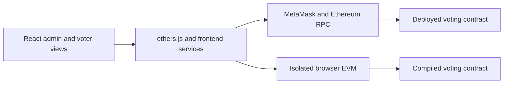

# VoteChain

**An Ethereum voting application with scheduled elections, wallet-based access, and auditable tallies.**

**[Open the live sandbox](https://y-ash-y.github.io/DecentralizedVotingSystem/)** ·
[Architecture](docs/ENGINEERING.md) · [Verification](docs/VERIFICATION.md) ·
[Security review](docs/SECURITY-REVIEW.md)

[](https://github.com/Y-ash-Y/DecentralizedVotingSystem/actions/workflows/build-and-tests.yml?query=branch%3Amain)

VoteChain pairs a React interface with Solidity contracts. Administrators
register candidates and enroll voter wallets, then seal the election before
it starts. Eligible voters can cast a public ballot or commit to a choice and
reveal it later. The contract enforces who can act, when they can act, and
which ballots count.

## Try it in your browser

The sandbox runs the **same interface and compiled voting contract** in an
isolated Ethereum Virtual Machine inside your browser. GitHub Pages serves the
app, and each tab gets its own chain. No wallet extension, account signup,
terminal, or test ETH is needed.

1. Enter as **Demo Admin**. Create a commit–reveal election, register at least
   two candidates, authorize the displayed voter address, and select **Seal Setup**.
2. Switch to **Demo Voter**, open the election, and use **Advance 1 minute**
   to reach the voting window. Select a candidate and commit your vote.
3. Advance to reveal, load the saved ballot, and reveal it. Advance past
   closing to see the final tally.

Reloading the sandbox resets the chain and its in-memory ballot backups.
For actual wallet signatures, use the [local MetaMask walkthrough](#run-the-local-wallet-demo).

## Architecture



| Component | Responsibility |
| --- | --- |
| [Solidity contracts](VotingDapp/contracts/README.md) | Enforce wallet roles, sealed setup, phase deadlines, ballot validity, and tallying. |
| [Frontend services](VotingDapp/voting-frontend/src/lib/README.md) | Bind commitments to the election, wallet, contract, and chain. Preserve recovery data before submitting and check transaction receipts. |
| [Chain reads](VotingDapp/voting-frontend/src/lib/chainData.js) | Page event logs, recheck cached checkpoints after chain reorganizations, and read final tallies at a fixed block. |
| [Browser sandbox](VotingDapp/voting-frontend/src/sandbox/) | Execute the voting bytecode with two local accounts and adjustable chain time. |

**Design trade-offs.** Sealing freezes candidates and eligibility so an
administrator cannot change them once voting is underway. Scheduled transitions
follow block timestamps, so the administrator need not send a transaction to
open each phase. Commit–reveal hides choices during voting, at the cost of a
second transaction and a secret the voter must retain. Only valid reveals count.

**Measured gas cost.** Authorizing ten addresses used **311,139 gas** in a
batch versus **621,530 gas** across ten individual transactions, a **49.94%
reduction** in the controlled local benchmark. See the
[benchmark setup and limits](docs/BENCHMARKS.md).

## Tests and build

The test suite covers the contract and local EVM, frontend services, wallet and
receipt handling, browser layouts, and an end-to-end election through the
browser sandbox. The **Build & Tests** badge tracks verification on `main`.
The [Dependency Audit workflow](https://github.com/Y-ash-Y/DecentralizedVotingSystem/actions/workflows/dependency-audit.yml)
reports contract and frontend dependency findings separately.

Use the Node.js version pinned in [`.nvmrc`](.nvmrc). Install both packages
and apply the reviewed contract-tooling patch.

```sh
npm ci --ignore-scripts --prefix VotingDapp
npm ci --ignore-scripts --prefix VotingDapp/voting-frontend
npm --prefix VotingDapp run deps:patch
```

From the repository root:

```sh
npm --prefix VotingDapp test
npm --prefix VotingDapp/voting-frontend test
npm --prefix VotingDapp/voting-frontend run test:ui
npm --prefix VotingDapp/voting-frontend run build
```

To reproduce the browser checks after the ordinary contract test compiles
the Solidity artifacts:

```sh
cd VotingDapp/voting-frontend
npx playwright install chromium
npm run test:browser
npm run test:sandbox
```

See [verification](docs/VERIFICATION.md) for coverage, deployment smoke checks,
and benchmark reproduction.

## Run the local wallet demo

Use the same installations above and two MetaMask accounts. From `VotingDapp`,
leave `npm run demo:node` running in one terminal. In a second terminal, run:

```sh
npm run demo:setup -- <ADMIN_PUBLIC_ADDRESS> <VOTER_PUBLIC_ADDRESS>
npm run demo:ui
```

Open the app at **http://127.0.0.1:5174**. Use the MetaMask custom RPC
`http://127.0.0.1:8545` with chain ID `31337` and currency `ETH`. The local
balances have no monetary value. Supply public addresses only. The
[wallet walkthrough](docs/MANUAL-WALLET-TESTS.md) covers setup, phase timing,
and ballot recovery. The [Sepolia runbook](docs/DEPLOYMENT.md) covers public
testnet configuration and deployment.

## Security and scope

VoteChain is an educational prototype for non-binding elections. Eligibility
depends on an administrator's enrollment decisions. Commit–reveal provides
temporary concealment, and the reveal exposes the choice and wallet on-chain.
Real-wallet ballot backups are plaintext. Keep backups and deployment credentials
private. The project has internal review and automated checks.

The contract tooling currently flags a [Zod memory-exhaustion advisory](https://github.com/advisories/GHSA-mrhx-c7xc-m3w5).
The local mitigation covers bounded Zod collections. The strict audit still
reports the advisory, and the hosted browser bundle uses a separate dependency
tree. See the [dependency notes](docs/DEPENDENCIES.md) for the scope and policy.

## License

The root [license](LICENSE) declares MIT. The nested [project license](VotingDapp/LICENSE),
Solidity source headers, and package metadata declare MPL-2.0.
